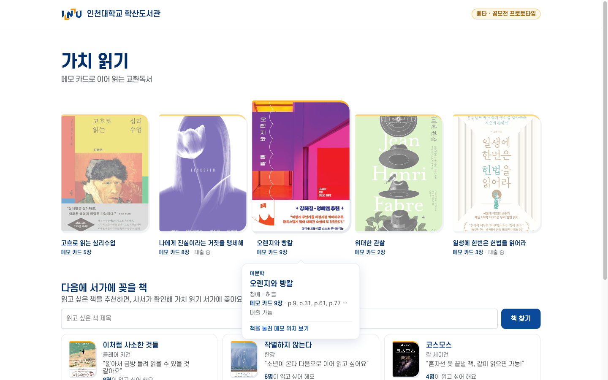
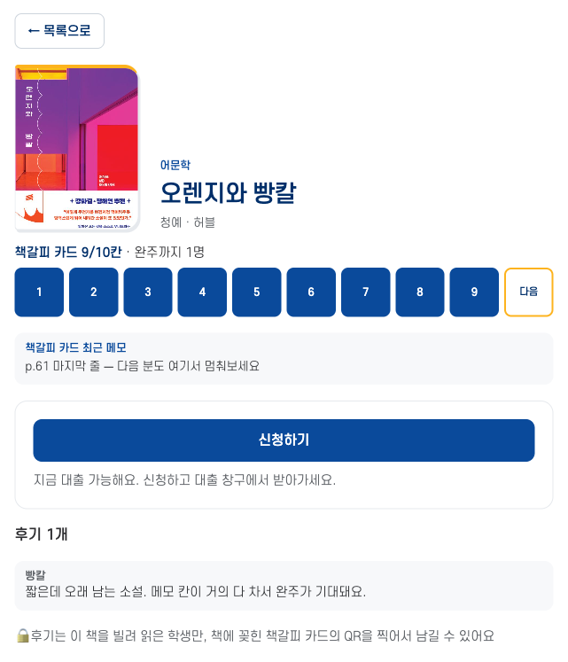
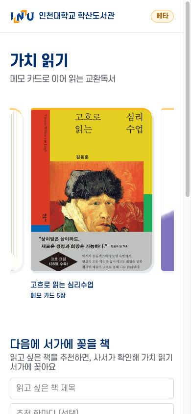

# 가치 읽기 — 메모 카드로 이어 읽는 교환독서

인천대학교 학산도서관 서비스 아이디어 공모전 제안 「가치 읽기」의 현황 페이지 프로토타입입니다.
읽다 멈춘 페이지에 **메모 카드**를 끼워 감상·질문·답글을 자유롭게 남기고, 다음에 빌린 학생이 그 페이지에서 앞사람의 생각을 발견하는 교환독서입니다.
국립중앙도서관 사서추천도서 Open API의 실제 데이터를 보여줍니다.

**👉 https://gachi-reading.vercel.app**



## 주요 기능

### 가치 읽기 서가
서가에 있는 책이 책장처럼 놓이고, 표지 아래에 **끼워진 메모 카드 수**와 대출 중 여부가 보입니다.
PC에서는 책에 마우스를 올리면 말풍선으로 메모가 있는 페이지와 대출 상태가 나옵니다.

### 메모는 어느 페이지에 있는지만
책을 누르면 메모 카드가 끼워진 **페이지 번호**만 보여줍니다(같은 페이지에 여러 장이면 답글). 내용은 책을 빌려서 그 페이지를 펼쳐야 볼 수 있어서, 앞사람의 생각을 직접 발견하게 됩니다.



### 다음에 서가에 꽂을 책
읽고 싶은 책 제목으로 검색해 실제 책을 골라 추천하고, 다른 학생은 **나도 읽을래요**로 함께합니다. 사서가 확인해 가치 읽기 서가에 꽂습니다.
많이 원하는 순으로 3권만 먼저 보여주고, 같은 책을 다시 추천하면 기존 책에 합쳐집니다. 이미 서가에 있는 책은 그 책으로 안내합니다.


### 모바일
폰에서는 가운데 한 권이 크게 보이는 가로 스크롤 책장이 되고, 마지막 책 다음에 첫 책이 이어집니다.

<p>
  
  
</p>

## 구조

| 파일 | 역할 |
|---|---|
| `index.html` | 현황 페이지: 가치 읽기 서가(PC는 마우스 올리면 말풍선, 폰은 가로 스크롤) · 책별 메모 카드 페이지 · 다음에 서가에 꽂을 책(추천) |
| `api/books.js` | Vercel 함수: 사서추천도서 + 예시 릴레이 정보 |
| `api/cover.js` | Vercel 함수: 표지 주소 (국중도 → 카카오 → 구글 북스) |
| `api/search.js` | Vercel 함수: 책 추천용 제목 검색 (카카오, 키 없으면 구글 북스) |
| `lib/library.js` | API 호출 로직 (키는 환경 변수에서만 읽음) |
| `data/state.js` | 예시 데이터: 책별 메모 카드가 끼워진 페이지·대출 상태, 추천 도서 |
| `data/snapshot.js` | 비상용 스냅샷: 국중도 API가 실패해도 책 5권·표지를 대신 보여줌 |
| `inu-logo.png` | 헤더 INU 로고 |
| `docs/screenshots/` | README 스크린샷 |
| `dev-server.js` | 로컬 확인용 서버 (`npm start`) |

## Vercel 배포

1. GitHub에 새 저장소를 만들어 이 폴더를 올립니다. `.env`는 `.gitignore`에 있어서 올라가지 않습니다.
2. vercel.com → Add New → Project → 저장소 Import
3. Framework Preset은 **Other**, 나머지는 기본값
4. **Environment Variables**에 `NL_API_KEY`(필수), `KAKAO_REST_KEY`(선택) 입력
5. Deploy

CLI로 올릴 때: `npm i -g vercel` → `vercel` → `vercel env add NL_API_KEY` → `vercel --prod`

## 로컬 확인

```bash
cp .env.example .env   # 키 입력
npm start              # http://localhost:3000
```

## 알아둘 점

- API 키는 Vercel 서버 쪽에만 있고 브라우저로 나가지 않습니다. 키가 없거나 API가 멈추면(4초 타임아웃) `data/snapshot.js`로 대신 보여줍니다.
- `/api/books`는 10분, `/api/cover`는 하루 동안 Vercel CDN에 캐시돼서, 방문자가 많아도 국중도·카카오 API 호출이 크게 늘지 않습니다.
- 메모 카드 수·대출 상태는 예시 데이터입니다(`data/state.js`). 책 추천은 브라우저(localStorage)에만 저장됩니다. 실제 운영에서는 도서관 대출 시스템·서버 저장소와 연동합니다.
- 폰트는 인천대 홈페이지와 같은 에스코어드림(눈누 CDN)입니다.
- 공모전 제안용 프로토타입이며 학산도서관 공식 서비스가 아닙니다.
