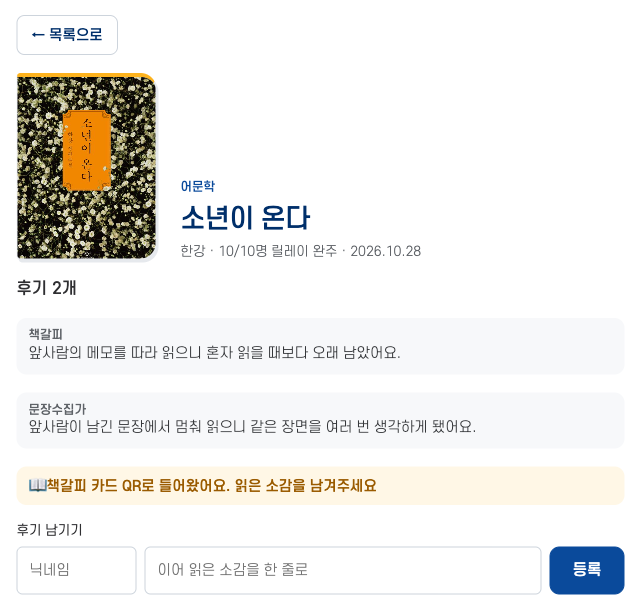
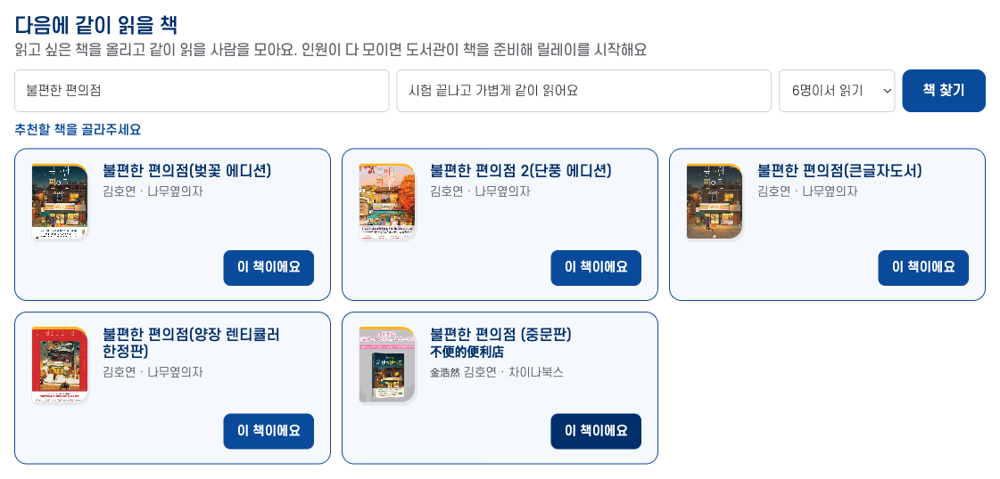
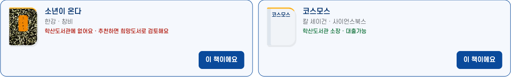
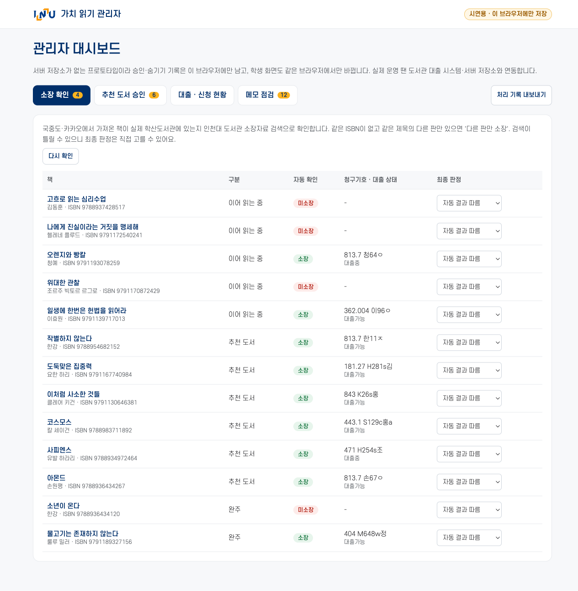
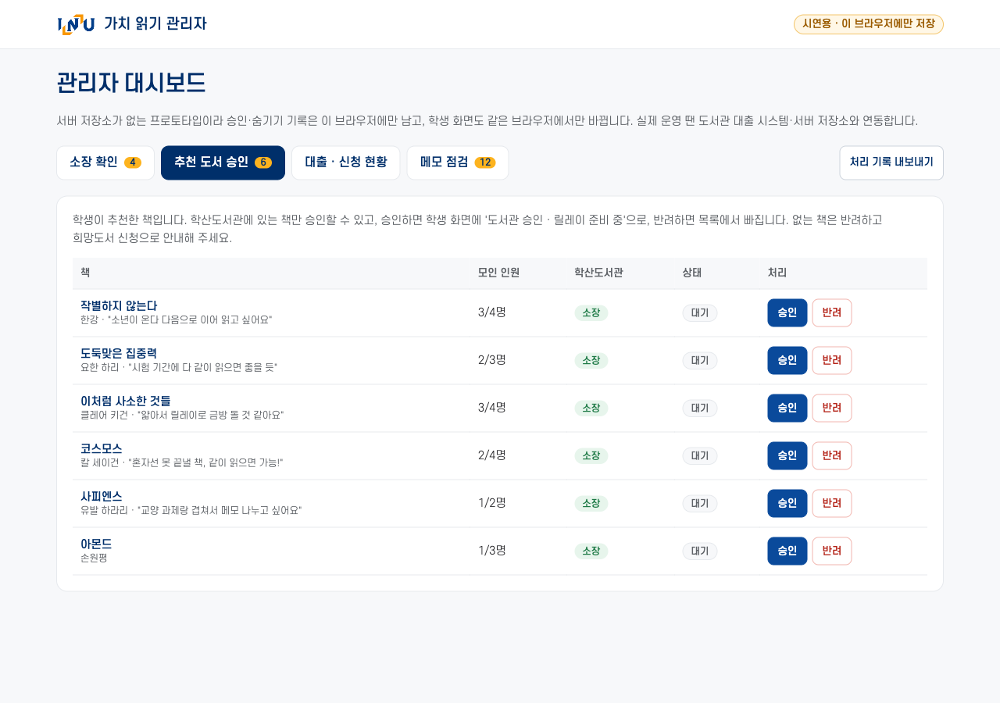
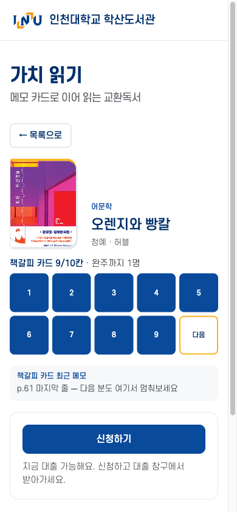

# 가치 읽기 — 메모 카드로 이어 읽는 교환독서

> 🏆 **2026 학산도서관 서비스 아이디어 공모전 우승**

인천대학교 학산도서관 서비스 아이디어 공모전 제안 「가치 읽기」의 현황 페이지 프로토타입입니다.
한 권의 책을 2~4명이 차례로 빌려 읽으며, 책과 함께 넘겨지는 **메모 카드장**에 생각을 이어 남깁니다. 긴 이야기는 카드의 QR로 이 페이지에 남깁니다.
국립중앙도서관 사서추천도서 Open API의 실제 데이터를 보여줍니다.

**👉 https://gachi-reading.vercel.app**


## 주요 기능

### 지금 이어 읽는 책
사서추천도서 5권이 책장처럼 놓이고, 표지 아래에 참여 인원과 진행 막대가 보입니다. 2명 이하 남은 책은 **완주 임박**으로 표시됩니다.
PC에서는 책에 마우스를 올리면 말풍선으로 대출 상태와 신청 버튼이 나옵니다.

### 책 상세와 페이지별 메모
책을 누르면 읽은 사람 수(n/4명)와 페이지·줄에 남긴 메모를 볼 수 있고, 페이지 버튼으로 그 페이지 메모만 걸러 볼 수 있습니다. 메모는 카드의 QR(`#write` → 책 고르기)로 들어와야 쓸 수 있습니다.


### 후기는 책갈피 카드 QR로
후기 입력칸은 책에 꽂힌 **책갈피 카드의 QR**(`#book/<ISBN>/qr`, `#done/<id>/qr`)로 들어왔을 때만 열립니다. 실물 책을 빌려 읽은 학생만 후기를 남길 수 있고, 완주한 책도 같습니다.



### 다음에 같이 읽을 책
읽고 싶은 책 제목으로 검색해 실제 책을 고르고, 같이 읽을 인원(2·3·4명)을 정하면 첫 번째 신청자가 되고, 다른 학생은 **나도 읽을래요**로 함께합니다. 인원이 다 모이면 다음 릴레이가 시작됩니다. 검색으로 고른 책만 올라가서 아무 글자나 추천되지 않고, 카드에는 책 표지가 함께 보입니다.
인원 대비 많이 모인 순으로 3권만 먼저 보여주고, 같은 책을 다시 추천하면 기존 책에 합쳐집니다. 이미 이어 읽는 중이거나 완주한 책은 추천 대신 그 책으로 안내합니다.




검색 결과마다 **학산도서관 소장 여부**가 함께 나옵니다. 국중도·카카오에는 있지만 학산도서관에는 없는 책은 "학산도서관에 없어요"로 표시되고, 추천하면 희망도서로 검토합니다.



### 관리자 대시보드 (`/admin.html`)
사서·근로장학생용 화면입니다. 시연용이라 처리 기록은 그 브라우저에만 저장됩니다.

- **소장 확인**: 이어 읽는 책·추천 도서·완주한 책이 실제 학산도서관에 있는지 인천대 도서관 소장자료 검색으로 확인합니다. 같은 ISBN이면 *소장*, 같은 제목의 다른 판만 있으면 *다른 판만 소장*, 없으면 *미소장*. 청구기호·대출 상태도 보여주고, 검색이 틀리면 최종 판정을 직접 고를 수 있습니다.
- **추천 도서 승인**: 학산도서관에 있는 책만 승인할 수 있습니다. 승인하면 학생 화면에 "도서관 승인 · 릴레이 준비 중", 반려하면 목록에서 빠집니다.
- **대출 · 신청 현황**: 책별 읽은 사람, 대출 상태, 대기 인원. 반납된 책은 대출대에서 신청 명단 순서대로 다음 사람에게.
- **메모 점검**: QR로 남긴 메모를 보고, 부적절한 메모는 숨기면 학생 화면에서 빠집니다.
- **처리 기록 내보내기**: 처리 기록을 JSON 파일로 받아 `data/state.js` 반영이나 서버 저장소 이전에 씁니다.





### 모바일
폰에서는 가운데 한 권이 크게 보이는 가로 스크롤 책장이 되고, 마지막 책 다음에 첫 책이 이어집니다. 좁은 폰에서는 책갈피 카드가 5칸 × 2줄로 바뀝니다.

<p>
  
  
</p>

## 구조

| 파일 | 역할 |
|---|---|
| `admin.html` | 관리자 대시보드: 소장 확인 · 추천 도서 승인 · 대출/신청 현황 · 메모 점검 |
| `index.html` | 현황 페이지: 지금 이어 읽는 책 5권(PC는 마우스 올리면 말풍선, 폰은 가로 스크롤) · 완주한 책 · 다음에 같이 읽을 책(추천) |
| `api/books.js` | Vercel 함수: 사서추천도서 + 예시 릴레이 정보 |
| `api/cover.js` | Vercel 함수: 표지 주소 (국중도 → 카카오 → 구글 북스) |
| `api/search.js` | Vercel 함수: 책 추천용 제목 검색 (카카오, 키 없으면 구글 북스) |
| `api/holding.js` | Vercel 함수: 학산도서관 소장 확인 (인천대 도서관 소장자료 검색, 키 없음) |
| `lib/library.js` | API 호출 로직 (키는 환경 변수에서만 읽음) |
| `data/state.js` | 예시 데이터: 책별 참여 인원·대출 상태, 완주한 책 후기, 추천 도서 |
| `data/snapshot.js` | 비상용 스냅샷: 국중도 API가 실패해도 책 5권·표지를 대신 보여줌 |
| `inu-logo.png` | 헤더 INU 로고 |
| `docs/screenshots/` | README 스크린샷 |
| `dev-server.js` | 로컬 확인용 서버 (`npm start`) |

## 시범 운영 계획 (공모전 제안)

| 항목 | 내용 |
|---|---|
| 책 | 학산도서관 소장 도서 5권 (신규 구매 없음) |
| 기간 | 준비 2주 + 운영 8주 (시험 기간 제외) |
| 안내 | 포스터 · 안내 화면. 반납된 책은 대출대에 두었다가 다음 신청자에게 |
| 역할 | 사서: 도서 선정 확인 · 근로장학생: 반납 때 빈 카드 채우기, 주 1회 점검 |
| 비용 | 책 1권에 카드장 1개, 최대 약 800원 (QR 카드 1장 + 카드링 1개 + 빈 카드 최대 36장) · 시범 운영 약 4천 원 |

## Vercel 배포

1. GitHub에 새 저장소를 만들어 이 폴더를 올립니다. `.env`는 `.gitignore`에 있어서 올라가지 않습니다.
2. vercel.com → Add New → Project → 저장소 Import
3. Framework Preset은 **Other**, 나머지는 기본값
4. **Environment Variables**에 `NL_API_KEY`(필수), `KAKAO_REST_KEY`(선택) 입력
5. Deploy

CLI로 올릴 때: `npm i -g vercel` → `vercel` → `vercel env add NL_API_KEY` → `vercel --prod`

## 로컬 확인

```bash
cp .env.example .env   # 키 입력
npm start              # http://localhost:3000
```

## 알아둘 점

- API 키는 Vercel 서버 쪽에만 있고 브라우저로 나가지 않습니다. 키가 없거나 API가 멈추면(4초 타임아웃) `data/snapshot.js`로 대신 보여줍니다.
- `/api/books`는 10분, `/api/cover`는 하루 동안 Vercel CDN에 캐시돼서, 방문자가 많아도 국중도·카카오 API 호출이 크게 늘지 않습니다.
- 도서관 지정 책의 기본 인원은 4명입니다 (`lib/library.js`의 `RELAY_MAX`). 교환독서는 보통 2~4명이고, 많으면 완주까지 너무 오래 걸립니다.
- 참여 인원·대출 상태는 예시 데이터입니다. 교환독서 신청·메모·책 추천과 관리자 처리 기록은 브라우저(localStorage)에만 저장됩니다. 실제 운영에서는 도서관 대출 시스템·서버 저장소와 연동합니다.
- 소장 확인(`checkHolding`, `lib/library.js`)은 인천대 도서관 홈페이지가 쓰는 검색 주소를 부릅니다. 공식 공개 API가 아니라 주소가 바뀌면 *확인 실패*로 나오고, 실제 운영 땐 도서관 공식 연동으로 이 함수만 바꾸면 됩니다. 결과는 1시간 캐시됩니다.
- 관리자 화면은 시연용이라 잠금이 없습니다. 실제 운영 땐 학교 계정 로그인 뒤에 둡니다.
- 폰트는 인천대 홈페이지와 같은 에스코어드림(눈누 CDN)입니다.
- 공모전 제안용 프로토타입이며 학산도서관 공식 서비스가 아닙니다.
